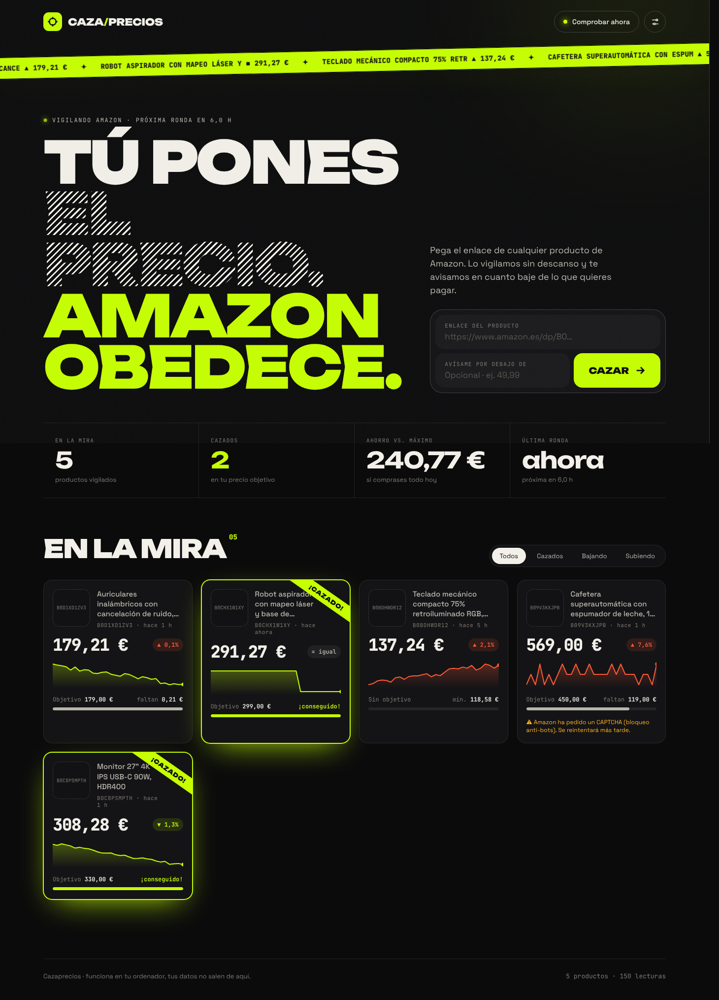

# CAZA/PRECIOS 🎯

**Tú pones el precio. Amazon obedece.**
Pega el enlace de cualquier producto de Amazon, di cuánto quieres pagar, y Cazaprecios lo vigila y te avisa cuando baje. Sin terminal.



## Qué hace
- 🔗 Pegas un enlace de Amazon (`.es`, `.com`, `.com.mx`, `.de`…) y empieza a vigilar ese producto.
- 📈 Muestra el historial de precios de cada producto en una gráfica interactiva, con su mínimo, su máximo y el precio actual.
- 🎯 Te deja poner un precio objetivo y marca el producto como **¡CAZADO!** cuando lo alcanza.
- 🔔 Te avisa en el navegador y, si lo configuras, también en el móvil por Telegram.
- ⏱️ Comprueba los precios solo, cada 1, 3, 6, 12 o 24 horas.
- 🔒 Funciona entero en tu ordenador y tus datos no salen de él.

## Cómo abrirlo (doble clic)
1. Instala **Python 3** desde [python.org](https://www.python.org/downloads/). En Windows, marca **"Add Python to PATH"**.
2. Descarga este proyecto: botón verde **Code** → **Download ZIP** → descomprímelo.
3. Haz doble clic en el lanzador de tu sistema:
   - **Windows:** `Iniciar Cazaprecios.bat`
   - **Mac:** `Iniciar Cazaprecios.command`. La primera vez: clic derecho → Abrir.
   - **Linux:** `iniciar.sh`

El navegador se abre solo. La primera vez tarda un minuto mientras instala lo que necesita. Queda abierta una ventanita: minimízala mientras uses Cazaprecios y ciérrala para apagarlo.

## Avisos en el móvil (opcional)
Abre **Ajustes** (el botón ⚙) y sigue los pasos para conectar un bot de Telegram. Hay un botón para enviar un mensaje de prueba.

## A tener en cuenta
- Amazon a veces bloquea las comprobaciones automáticas con un CAPTCHA. Cazaprecios lo detecta, lo señala en la tarjeta y vuelve a intentarlo en la siguiente ronda. Funciona mejor comprobando cada pocas horas que cada hora.
- Leer las páginas de Amazon de forma automática va contra sus condiciones de uso. Esto es solo para uso personal. Para algo comercial, usa la *Product Advertising API* oficial.

## Para desarrolladores
```
app.py          Servidor web local (Flask) + programador automático
core.py         Lectura de Amazon, base de datos SQLite y avisos
static/         Interfaz (HTML/CSS/JS, sin frameworks)
test_core.py    Pruebas  →  pip install pytest && pytest -q
```
